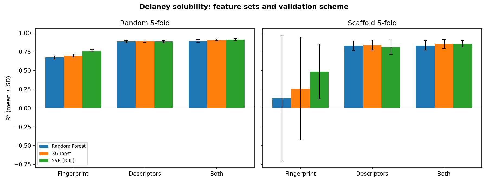
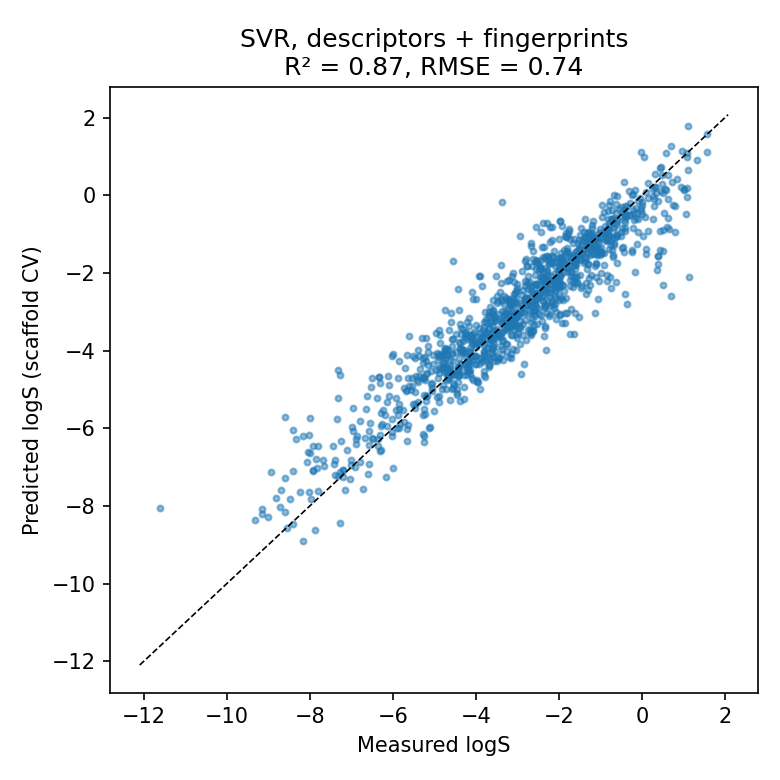

# Delaney Solubility QSAR: Splits, Features and Validation

Predicts aqueous solubility (logS) for 1,128 molecules from the Delaney (ESOL) dataset, and tests how the choice of features and validation scheme changes the result.

## Question
How much does a random split overstate performance compared with a scaffold split, and which features generalize best?

## Method
- **Data:** Delaney dataset, 1,128 molecules, 0 invalid SMILES
- **Features:** Morgan fingerprints (radius 2, 2048 bits); 8 RDKit descriptors (logP, MW, TPSA, H-bond donors and acceptors, rotatable bonds, rings, aromatic fraction); both combined
- **Models:** Random Forest, XGBoost, SVR (RBF), plus a mean baseline
- **Validation:** single 80/20 split (random and scaffold), then 5-fold CV with random folds and scaffold-grouped folds. Scalers are fitted inside each fold to avoid leakage.
- **Sanity check:** y-randomization (shuffled targets, scaffold CV). Mean R² = [PASTE], close to zero as expected for a model with no leakage.

## Key results
| Features | Random 5-fold R² | Scaffold 5-fold R² |
|---|---|---|
| Fingerprint only | 0.67 to 0.76 | 0.14 to 0.49 (very unstable) |
| Descriptors only | 0.885 to 0.892 | 0.81 to 0.84 |
| Descriptors + fingerprint | 0.894 to 0.911 | 0.83 to 0.86 |

- Descriptor-based models generalize to new scaffolds far better than fingerprint-only models.
- On a single 80/20 split, fingerprint-only R² fell from 0.72 to 0.79 (random split) to 0.32 to 0.47 (scaffold split).
- Adding fingerprints to descriptors gives a small, consistent gain that is within the fold-to-fold noise.
- SVR and XGBoost perform equivalently within error.

*Mean R² (± SD over 5 folds) for three models and three feature sets, using random folds (left) and scaffold-grouped folds (right).*

## Version history
- **v1:** Random Forest on 5 RDKit descriptors, single random split, test R² 0.851.
- **v2 (this notebook):** fingerprints vs descriptors, three models, random and scaffold validation, 5-fold CV and a y-randomization check.

## Limitations
- Small dataset (1,128 molecules), one random seed, fixed hyperparameters, no external test set.
- Differences between the top models are within one standard deviation.

## Files
`delaney_qsar_upgrade.ipynb`, `cv_results.csv`, `single_split_results.csv`, `delaney_cv_comparison.png`, `delaney_pred_vs_actual.png`

## Tools
Python, pandas, NumPy, RDKit, scikit-learn, XGBoost, Matplotlib, Google Colab

## Author
Suraj Gade | GitHub: surajgade17
